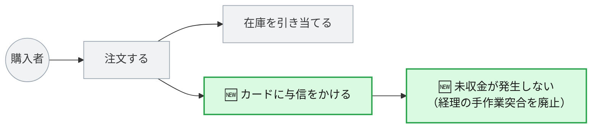
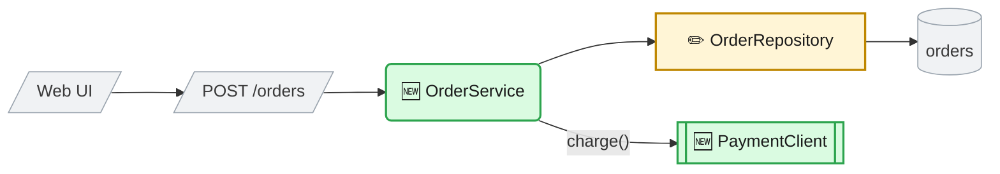
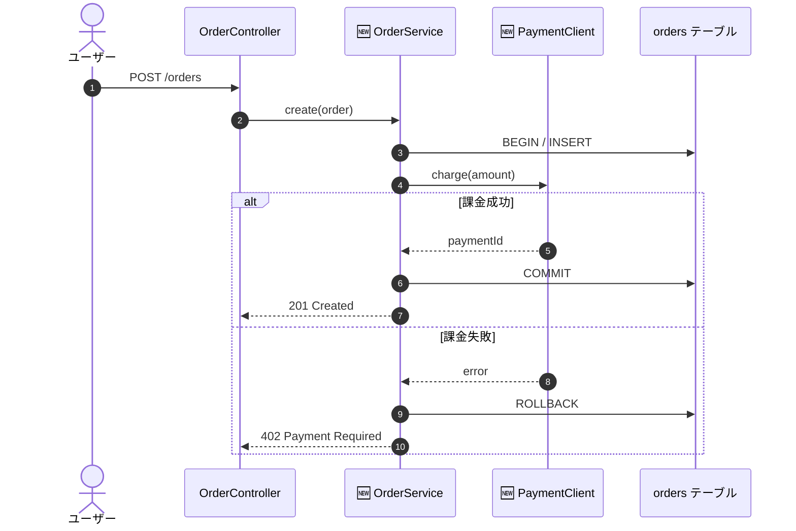
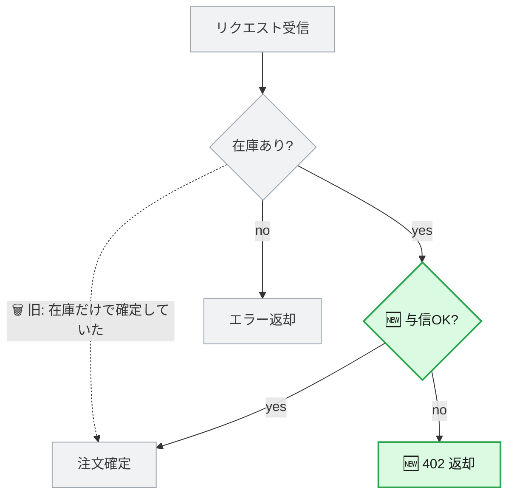
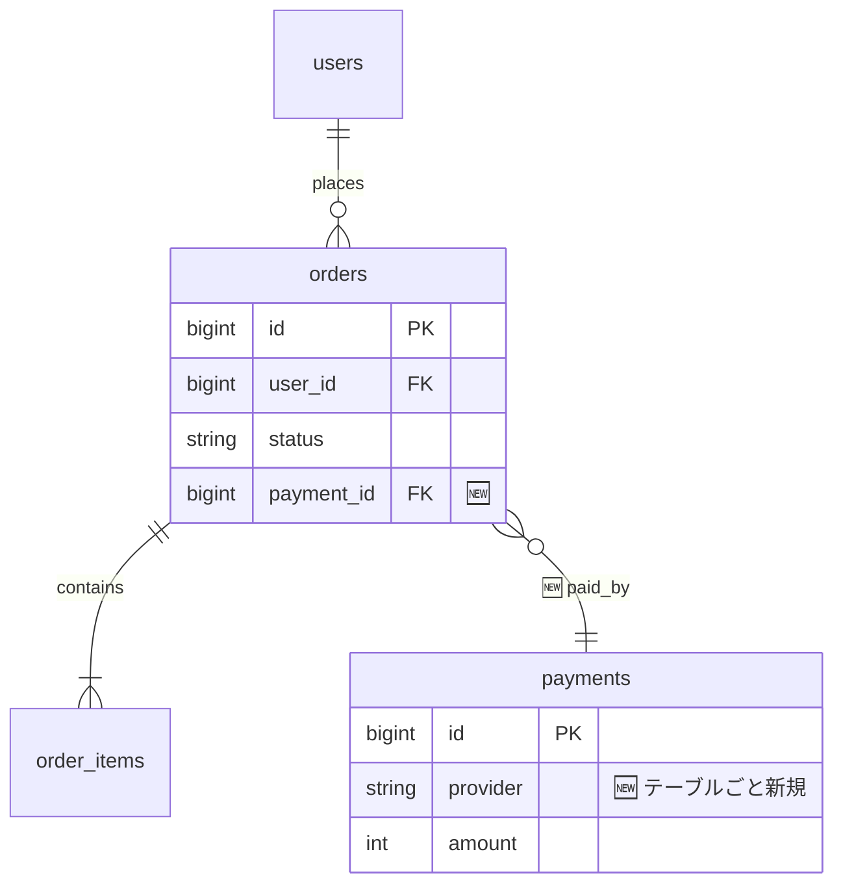
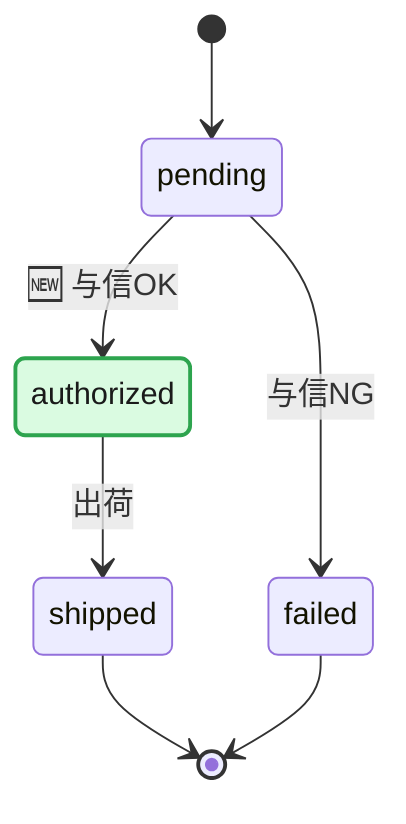
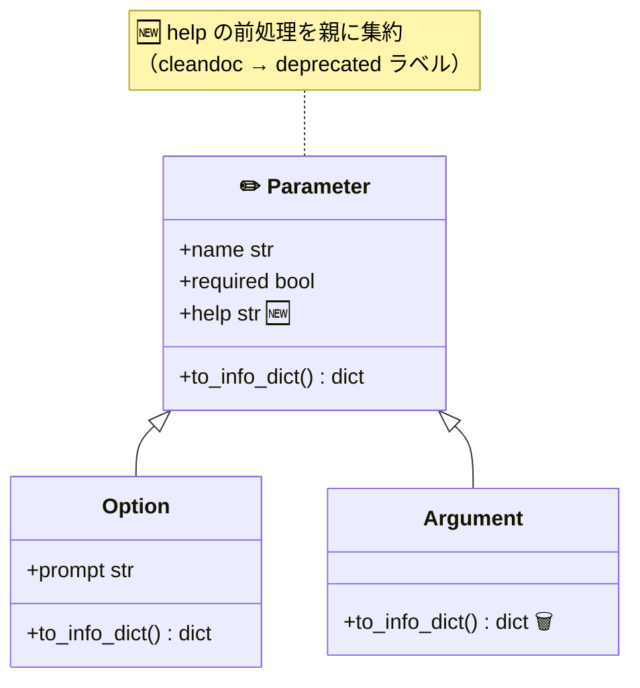
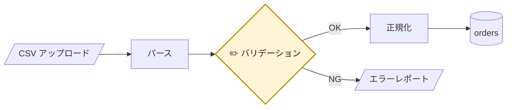

# 設計資料向け Mermaid パターン集

コピペで使える出発点と、GitHub での描画を壊す構文の罠をまとめたもの。
Step 4 で選んだ図の種類のセクションだけ読めばよい。全体を読む必要はない。

ページには4つの枠がある — 要件 (flowchart) / 基本設計 (component flowchart) / 詳細設計-構造
(classDiagram) / 詳細設計-振る舞い (sequenceDiagram)。そのため以下のパターンのいくつかは、
5枚目を足すのではなく既存の図の中に追加の情報を持たせる方法を示している。

## 目次

- [共通の約束事](#共通の約束事)
- [要件ビュー (flowchart)](#要件ビュー-flowchart)
- [コンポーネントビュー (flowchart)](#コンポーネントビュー-flowchart)
- [シーケンス図](#シーケンス図)
- [Before / After を1枚に収める](#before--after-を1枚に収める)
- [2つの話題を1枚に畳み込む](#2つの話題を1枚に畳み込む)
- [ER図](#er図)
- [状態遷移図](#状態遷移図)
- [クラス図](#クラス図)
- [データパイプライン](#データパイプライン)
- [構文の罠](#構文の罠)
- [図を読めるものに保つ](#図を読めるものに保つ)

## 共通の約束事

マーカーはラベルに入れる（どのレンダラーでも、どのテーマでも描画されるため）:

| マーカー | 意味 |
|---|---|
| 🆕 | この変更で追加された |
| ✏️ | この変更で変更された |
| 🗑 | この変更で削除された |
| （無し） | 既存。文脈のために表示している |

`flowchart` と `stateDiagram-v2` 用の `classDef` ブロック。`color:` の値は省略可能ではない — これが無いと GitHub のダークテーマでは、この淡い塗りの上のラベルが読めなくなる:

```
classDef added fill:#dafbe1,stroke:#2da44e,stroke-width:2px,color:#1a1a1a
classDef changed fill:#fff5d6,stroke:#bf8700,stroke-width:2px,color:#1a1a1a
classDef removed fill:#ffe2e0,stroke:#cf222e,stroke-width:2px,color:#1a1a1a
classDef context fill:#f0f2f4,stroke:#9aa4ae,color:#3a3a3a
```

形状の語彙。一貫して使うことで、形そのものが意味を持つようになる:

| 形状 | 構文 | 用途 |
|---|---|---|
| 長方形 | `A["名前"]` | モジュール、サービス、クラス |
| 角丸 | `A("名前")` | 処理、ジョブ |
| 円柱 | `A[("orders")]` | データストア、テーブル |
| サブルーチン | `A[["ExternalClient"]]` | 外部システム、サードパーティAPI |
| ひし形 | `A{"条件"}` | 分岐 |
| 平行四辺形 | `A[/"入力"/]` | エンドポイント、I/O境界 |

## 要件ビュー (flowchart)

答える問い: 誰が何をできるようになり、それがどんな問題を解くのか。要件の枠に入るもの。



一番右のノードには技術的な成果ではなく *業務上の* 成果を置くこと。レビュアーがコードを突き合わせる相手はその成果であり、それはたいてい PR 本文かコミットメッセージからしか得られない。ユーザーから見える変化の無い純粋なリファクタリングなら、代わりに構造上の約束を描く（「同じロジックが 2 箇所 → 1 箇所」）。1文で言い切れるなら、その1文を書いて図は省くこと。

## コンポーネントビュー (flowchart)

答える問い: 新しい部品はどこに位置し、何に依存するのか。



`LR` は層構造のシステム（UI → API → サービス → ストア）に向く。形がパイプラインではなく木になる場合は `TD` を使う。`subgraph` でまとめるのは、そのまとまり自体が情報である時だけにすること — ソースディレクトリごとの `subgraph` は、たいてい箱を増やすだけである。

## シーケンス図

答える問い: どの関数がどの関数をどの順で呼び、失敗した時に何が起きるのか。詳細設計-振る舞いの枠に入るもの。

メッセージには **引数付きの実在の関数名** を書く — `注文を作る` ではなく `create_order(user_id, items)`。その名前こそがレビュアーを図からコードへ飛ばす経路であり、文章のメッセージしか持たないシーケンス図はただの飾りである。



補足:

- `autonumber` はレビュアーがコメントで引用できるステップ番号を与える。既定で入れる価値がある。
- ここに `classDef` は存在しない。マーカーは `participant X as 🆕 Name` とメッセージラベル（`SVC->>PAY: ✏️ charge(amount, coupon)`）に置く。
- ハッピーパスだけを描くより `alt` / `opt` を使うこと。レビューで面白いのはたいていエラー分岐である。
- `Note over SVC,DB: ⚠️ 別トランザクション` は、レビューの旗をそれが当てはまるまさにその場所に立てる。2枚目の図を足さずにトランザクション境界を示す方法でもある。
- 並行処理には `par` … `and` … `end`、リトライには `loop`。
- 新しい状態は状態遷移図を足すのではなく `Note over SVC: 🆕 status = authorized` として畳み込む。
- 代表的な呼び出し経路1本に留めること。1枚に2経路を描くとどちらとしても読めなくなる。リスクの高い方を選び、もう一方はセクション5に1行書く。

## Before / After を1枚に収める

答える問い: 判断がどう変わったのか。図を2枚に分けると3つの枠のうち2つを使ってしまうので、旧経路は同じ flowchart 内に 🗑 と破線で残す。目は実線の経路を追いながら、破線が以前何をしていたかも見て取れる。



削除された経路には `-.->` を使い、そのラベルに以前何をしていたかを書く。Before と After がほとんど構造を共有しない場合 — 修正ではなく書き直しの場合 — は、並べて2枚描くのが誠実な選択である。詳細設計の枠をそれに充て、代わりに別のものを畳み込むこと。

## 2つの話題を1枚に畳み込む

2つ目の話題が示す価値はあるが枠を割くほどではない時は、既にある図に付ける:

| 2つ目の話題 | どこに置くか |
|---|---|
| 新しい状態 | シーケンス図に `Note over SVC: 🆕 authorized を経由` |
| 状態機械 | 各遷移を引き起こす呼び出しへの `Note over` 注記 |
| 2本目の呼び出し経路 | セクション5の1行。エントリポイント名を書く |
| スキーマ変更 | `DB[("orders<br/>🆕 payment_id")]` とラベル付けしたデータストアノード |
| 削除されたコード経路 | 同じ flowchart 内の 🗑 付き `-.->` 分岐 |
| 見つけたリスク | `Note over SVC,DB: ⚠️ 別トランザクション` |
| 依存の向き | 依存グラフを別に描かず、エッジラベルで表す |

畳み込むこともカットすることもできないなら、それはページのセクション4に1行として入るもの — 4枚目の図ではなく、ファイルと行を指す1文である。

## ER図

答える問い: どのテーブルとリレーションが変わったのか。



カーディナリティ: `||` はちょうど1、`o{` は0以上、`|{` は1以上。属性へのコメントは名前の後ろのクォート文字列で書く — 🆕 を置く場所はここである。変更が触れるテーブルと、その直接の隣接テーブルだけを載せること。

## 状態遷移図

答える問い: どんな状態があり、どの遷移が新しいのか。



古い `stateDiagram` ではなく必ず `stateDiagram-v2` を使う。状態名はノードIDの規則（ASCII）に従う。日本語は遷移ラベルか `state "表示名" as id` に置くこと。

## クラス図

答える問い: どんな型が存在し、どう関係し、何が移動したのか。詳細設計-構造の枠に入るもので、実在のメンバー名を載せている場合にのみスペースに見合う。



マーキング方法（いずれも Mermaid 11 で描画を確認済み）:

- **クラス名** — ラベル構文 `class Parameter["✏️ Parameter"]`。角括弧の部分が表示ラベルで、`Parameter` は関係や `note for` から参照されるIDとして残る。
- **メンバー** — マーカーは行の **末尾** に置く: `+help str 🆕`。先頭に置くと（`🆕 +help str`）ただのテキストとして解析され、`+name : type` の整形が失われる。
- **関係** — `OrderService --> PaymentClient : 🆕 uses`。
- **ノート** — `note for Parameter "..."` は、形では表現できない1文を載せる場所。

その他の知っておくべき構文:

- ジェネリクスは `~` を使う: `List~Order~`、`List<Order>` は不可。
- ステレオタイプ: `<<interface>>`、`<<abstract>>`、`<<enumeration>>` をクラス本体内の独立した行に書く。
- 関係: `<|--` 継承、`*--` コンポジション、`o--` 集約、`-->` 関連、`..>` 依存、`<|..` 実現。
- クラスだと分かる程度に未変更のメンバーをいくつか見せる。ただし API 全体は載せない — これは地図であって、ドキュメントではない。

クラスを持たないコード（手続き的なモジュール、フック、SQL）では代わりに `flowchart` を使う: モジュール1つにつき1箱、エクスポートされた関数を `<br/>` でラベル内に列挙し、import をエッジにする。この枠は構造についてのものであって、キーワードについてのものではない。

## データパイプライン

答える問い: データはどう形を変えるのか。



エッジには何が起きるかではなく、何が流れるかをラベルとして書くこと — 何が起きるかはノードが既に言っている。

## 構文の罠

以下は実際にドキュメントを壊すものである:

1. **クォートされていない特殊文字。** `A[POST /orders (v2)]` は失敗し、`A["POST /orders (v2)"]` は動く。`(` `)` `,` `:` `[` `]` `{` `}` `/` `"` を含むラベルは全てクォートすること。クォートして間違いになることは無いので、既定でクォートする。
2. **非ASCIIのノードID。** `注文[注文サービス]` は動作が不安定。`order["注文サービス"]` とする。
3. **ブロックキーワードと衝突するID。** `participant OPT as Option` は `opt` ブロックの開始として解析され、図全体を壊す — しかも大文字小文字を区別せずにマッチするので、大文字にしても助からない。シーケンス図では `alt opt loop par rect note box end and else critical break activate deactivate autonumber link participant actor` を避け、flowchart では `end` と `class` を避けること。`OPTC`、`PRM`、`DONE` のように改名し、本当の名前はラベルに置く。（`graph`、`style`、`click`、`subgraph`、`classDef`、`linkStyle` は flowchart のノードIDとして使って問題ない — 実際に描画して確認済み。）`check_mermaid.py` がこれらを検出する。
4. **ラベル内の `\n`。** `<br/>` を使う。
5. **`end` の過不足。** `subgraph`、`alt`、`opt`、`loop`、`par`、`rect`、`critical`、`break` にはそれぞれ小文字の `end` が必要。
6. **`classDef` より前の `class`。** 先に classDef を定義し、存在するクラスだけを参照すること。
7. **`color:` の無い `classDef`。** ダークモードで文字が見えなくなる。
8. **セミコロンと行末の余計な記号。** 最近の Mermaid は行末の `;` を必要としない。一貫性なく散らばっていると解析がおかしくなる。
9. **`graph` と `flowchart`。** `flowchart` を使う。`graph` は旧来のキーワードである。
10. **特殊文字を含むエッジラベル。** `A -->|"作成 (非同期)"| B` のようにクォートする。
11. **ブロック内の空行。** ほとんどの図では無害だが、`erDiagram` の属性ブロックでは壊れることがある — ブロックは連続させること。

## 図を読めるものに保つ

- ノード15個程度が上限。超えたら詳細を1つの箱に畳む（「認証まわり」）。2枚に分けると枠を1つ消費するので、まず畳むこと。
- エッジの交差は、本当の複雑さよりも、レイアウト方向の誤りやグルーピングの誤りを示していることの方が多い。
- シーケンス図の `participant` が7個を超えるなら、そのやり取りは2つのシナリオに分ける価値がある。
- 長いラベルは箱を引き伸ばしてレイアウトを壊す。25文字程度に収め、詳細は図の下のキャプションに逃がすこと。
