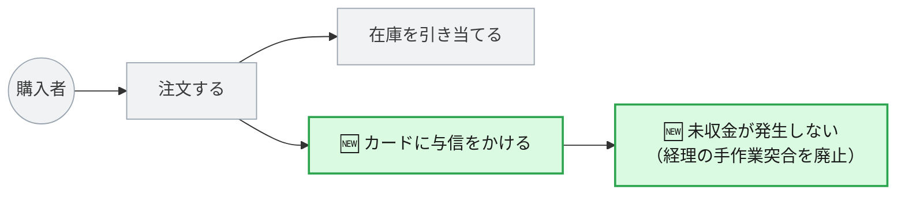
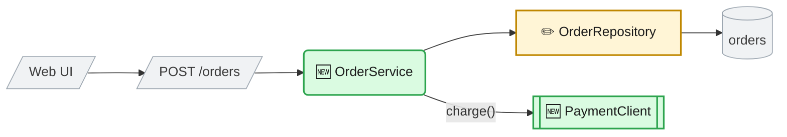
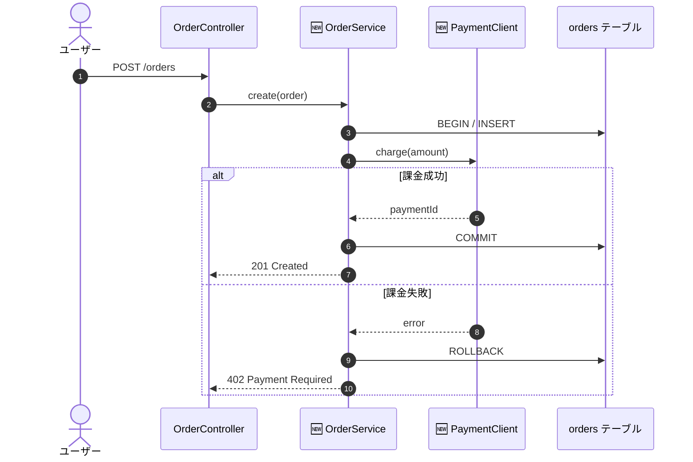
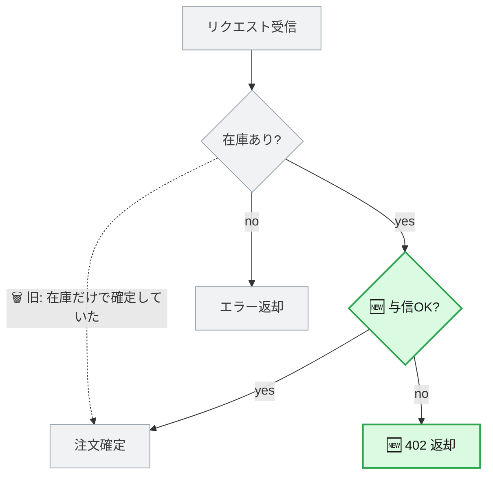
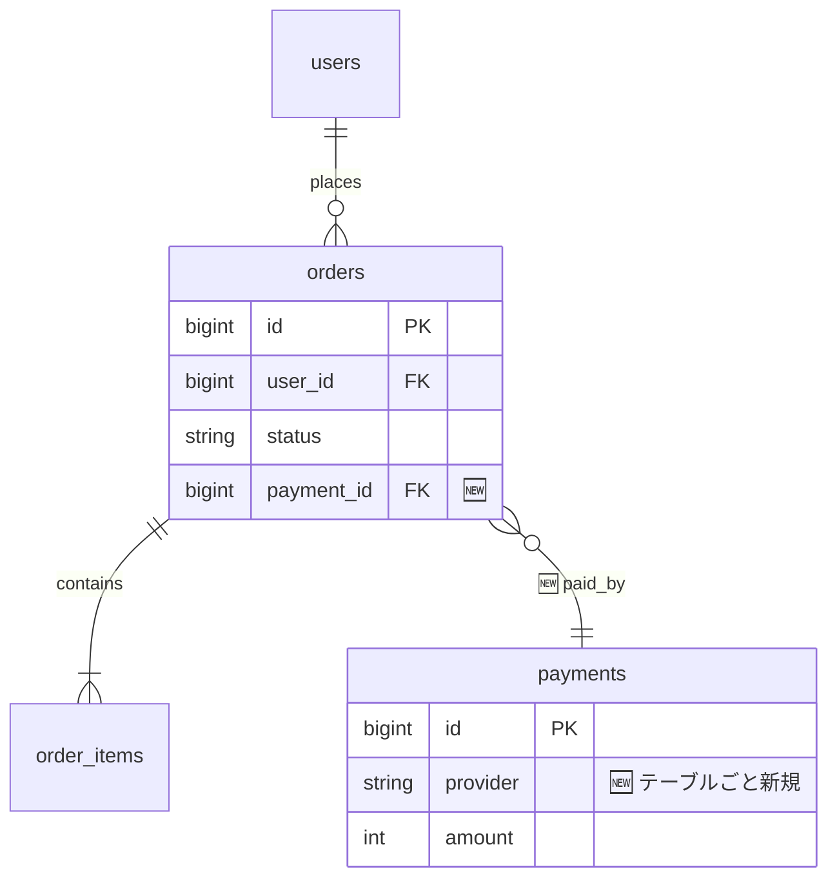
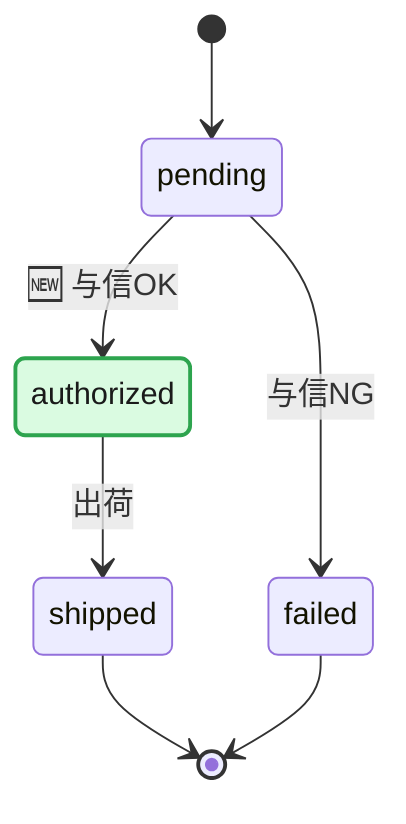
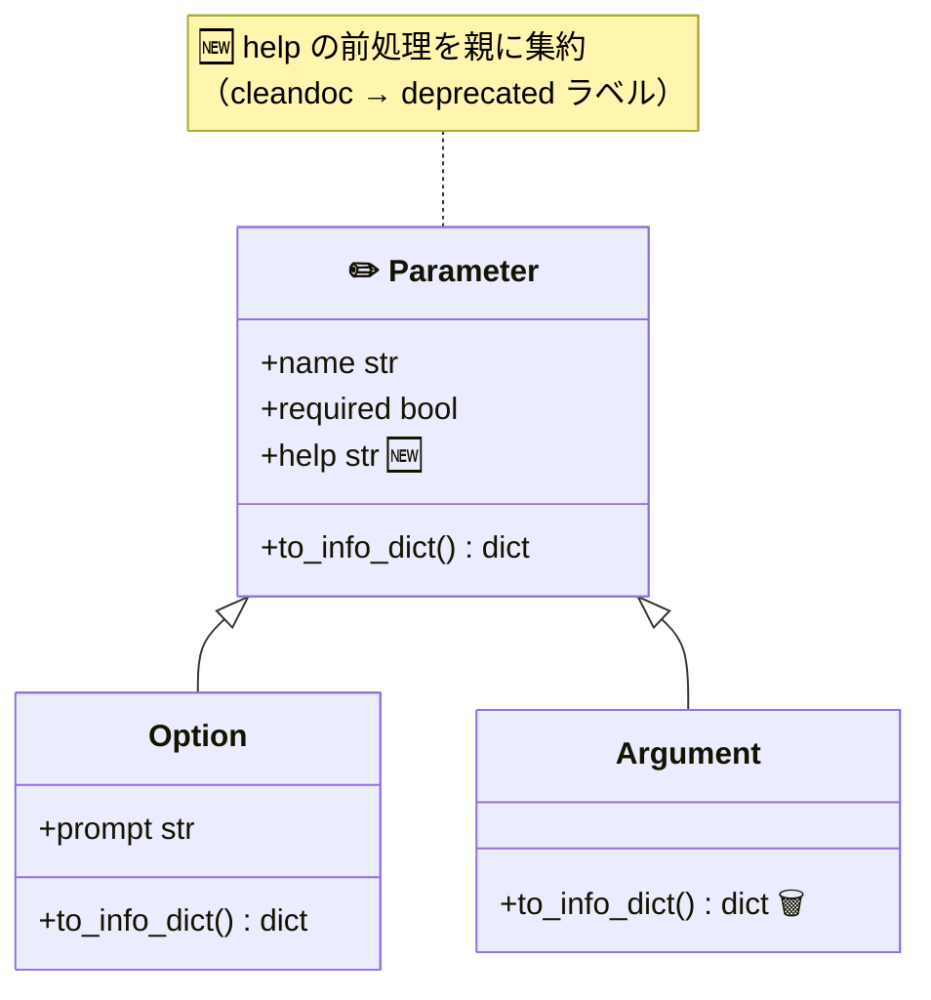
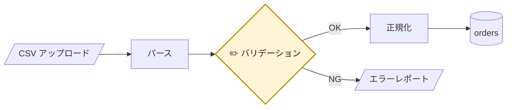

# Mermaid patterns for design briefs

Copy-paste starting points, plus the syntax traps that break rendering on GitHub.
Read the section for the diagram type you picked in Step 4 — no need to read the whole file.

The page has four slots — 要件 (flowchart) / 基本設計 (component flowchart) / 詳細設計-構造
(classDiagram) / 詳細設計-振る舞い (sequenceDiagram) — so several of these patterns show how to
carry an extra idea inside an existing diagram rather than adding a fifth.

## Contents

- [Shared conventions](#shared-conventions)
- [Requirement view (flowchart)](#requirement-view-flowchart)
- [Component view (flowchart)](#component-view-flowchart)
- [Sequence diagram](#sequence-diagram)
- [Before / after in one diagram](#before--after-in-one-diagram)
- [Folding two ideas into one diagram](#folding-two-ideas-into-one-diagram)
- [ER diagram](#er-diagram)
- [State diagram](#state-diagram)
- [Class diagram](#class-diagram)
- [Data pipeline](#data-pipeline)
- [Syntax traps](#syntax-traps)
- [Keeping diagrams readable](#keeping-diagrams-readable)

## Shared conventions

Markers go in labels (they render everywhere, in every theme):

| Marker | Meaning |
|---|---|
| 🆕 | added by this change |
| ✏️ | modified by this change |
| 🗑 | removed by this change |
| (none) | pre-existing, shown for context |

The `classDef` block for `flowchart` and `stateDiagram-v2`. The `color:` values are not optional — without them GitHub's dark theme renders unreadable labels on these pale fills:

```
classDef added fill:#dafbe1,stroke:#2da44e,stroke-width:2px,color:#1a1a1a
classDef changed fill:#fff5d6,stroke:#bf8700,stroke-width:2px,color:#1a1a1a
classDef removed fill:#ffe2e0,stroke:#cf222e,stroke-width:2px,color:#1a1a1a
classDef context fill:#f0f2f4,stroke:#9aa4ae,color:#3a3a3a
```

Shape vocabulary, used consistently so shapes themselves carry meaning:

| Shape | Syntax | Use for |
|---|---|---|
| Rectangle | `A["名前"]` | modules, services, classes |
| Rounded | `A("名前")` | processes, jobs |
| Cylinder | `A[("orders")]` | datastores, tables |
| Subroutine | `A[["ExternalClient"]]` | external systems, third-party APIs |
| Diamond | `A{"条件"}` | branches |
| Parallelogram | `A[/"入力"/]` | endpoints, I/O boundaries |

## Requirement view (flowchart)

Answers: who can now do what, and what problem does that solve? This is the 要件 slot.



Put the *business* outcome in the rightmost node, not the technical one — that outcome is what the reviewer checks the code against, and it is usually only available from the PR body or commit message. When the change is a pure refactor with no user-visible effect, draw the structural promise instead ("同じロジックが 2 箇所 → 1 箇所"). When one sentence covers it, write the sentence and skip the diagram.

## Component view (flowchart)

Answers: where does the new piece sit, and what does it depend on?



`LR` suits layered systems (UI → API → service → store). Use `TD` when the shape is a tree rather than a pipeline. Group with `subgraph` only when the grouping is itself information — a `subgraph` per source directory usually just adds boxes.

## Sequence diagram

Answers: which function calls which, in what order, and what happens when one fails? This is the 詳細設計-振る舞い slot.

Messages carry **real function names with their arguments** — `create_order(user_id, items)`, not `注文を作る`. Those names are how a reviewer jumps from the picture into the code; a sequence diagram with prose messages is decoration.



Notes:

- `autonumber` gives the reviewer step numbers to cite in comments — worth including by default.
- `classDef` does not exist here. Markers go in `participant X as 🆕 Name` and in message labels (`SVC->>PAY: ✏️ charge(amount, coupon)`).
- Prefer `alt` / `opt` over drawing only the happy path. The error branch is usually the interesting part of a review.
- `Note over SVC,DB: ⚠️ 別トランザクション` plants a review flag right where it applies, and is how transaction boundaries get shown without a second diagram.
- `par` … `and` … `end` for concurrency, `loop` for retries.
- Fold a new state in as `Note over SVC: 🆕 status = authorized` rather than adding a state diagram.
- Keep it to one representative call path. Two paths in one diagram read as neither; pick the riskier one and give the other a line in section 5.

## Before / after in one diagram

Answers: how did the decision change? Two separate diagrams would cost two of the three slots, so keep the old path in the same flowchart, marked 🗑 and dashed. The eye follows the solid path and sees what the dashed one used to do.



Use `-.->` for the removed path and say in its label what it used to do. If the before and after share almost no structure — a rewrite rather than an edit — then a side-by-side pair is the honest choice; spend the 詳細設計 slot on it and fold something else instead.

## Folding two ideas into one diagram

When a second idea is worth showing but not worth a slot, attach it to the diagram you already have:

| Second idea | Where it goes |
|---|---|
| a new state | `Note over SVC: 🆕 authorized を経由` on the sequence diagram |
| a state machine | `Note over` annotations on the calls that cause each transition |
| a second call path | one row in section 5, naming its entry point |
| a schema change | a datastore node labelled `DB[("orders<br/>🆕 payment_id")]` |
| a removed code path | a `-.->` branch marked 🗑 in the same flowchart |
| a risk you spotted | `Note over SVC,DB: ⚠️ 別トランザクション` |
| a dependency direction | an edge label rather than a separate dependency graph |

If it cannot be folded and cannot be cut, it belongs in section 4 of the page as one row of the review-attention table — a sentence that points at a file and line, not a fourth diagram.

## ER diagram

Answers: which tables and relations changed?



Cardinality: `||` exactly one, `o{` zero or more, `|{` one or more. Comments on attributes are quoted strings after the name — the place to put 🆕. Include only the tables that the change touches plus their immediate neighbours.

## State diagram

Answers: what states exist, and which transitions are new?



`stateDiagram-v2`, never the older `stateDiagram`. State names follow the node-ID rule (ASCII); put Japanese on the transition labels or in `state "表示名" as id`.

## Class diagram

Answers: what types exist, how are they related, and what moved? This is the 詳細設計-構造 slot, and it is worth its space only if it carries real member names.



Marking, all verified to render on Mermaid 11:

- **class name** — the label syntax `class Parameter["✏️ Parameter"]`. The bracket part is the display label; `Parameter` stays the ID used by relationships and `note for`.
- **member** — put the marker at the **end** of the line: `+help str 🆕`. A marker at the start (`🆕 +help str`) parses as plain text and loses the `+name : type` formatting.
- **relationship** — `OrderService --> PaymentClient : 🆕 uses`.
- **note** — `note for Parameter "..."` carries the one sentence that the shapes cannot.

Other syntax worth knowing:

- Generics use `~`: `List~Order~`, never `List<Order>`.
- Stereotypes: `<<interface>>`, `<<abstract>>`, `<<enumeration>>` on their own line inside the class body.
- Relationships: `<|--` inheritance, `*--` composition, `o--` aggregation, `-->` association, `..>` dependency, `<|..` realization.
- Show a handful of unchanged members so the class is recognizable, but not the whole API — this is a map, not the docs.

When the code has no classes (procedural modules, hooks, SQL), use a `flowchart` instead: one box per module, its exported functions listed in the label with `<br/>`, edges for imports. The slot is about structure, not about the keyword.

## Data pipeline

Answers: how does the data change shape?



Label the edges with what flows, not with what happens — the node already says that.

## Syntax traps

These are the ones that actually break documents:

1. **Unquoted special characters.** `A[POST /orders (v2)]` fails; `A["POST /orders (v2)"]` works. Quote any label with `(` `)` `,` `:` `[` `]` `{` `}` `/` or `"`. Quoting is never wrong — do it by default.
2. **Non-ASCII node IDs.** `注文[注文サービス]` is unreliable. Use `order["注文サービス"]`.
3. **IDs that collide with block keywords.** `participant OPT as Option` parses as the start of an `opt` block and kills the whole diagram — and the matching is case-insensitive, so uppercase does not save you. In sequence diagrams avoid `alt opt loop par rect note box end and else critical break activate deactivate autonumber link participant actor`; in flowcharts avoid `end` and `class`. Rename to `OPTC`, `PRM`, `DONE` and put the real name in the label. (`graph`, `style`, `click`, `subgraph`, `classDef`, `linkStyle` are fine as flowchart node IDs — verified by rendering.) `check_mermaid.py` flags these.
4. **`\n` in labels.** Use `<br/>`.
5. **Unbalanced `end`.** Every `subgraph`, `alt`, `opt`, `loop`, `par`, `rect`, `critical`, `break` needs a lowercase `end`.
6. **`class` before `classDef`.** Define the class first, and only reference classes that exist.
7. **A `classDef` without `color:`.** Renders as invisible text in dark mode.
8. **Semicolons and trailing punctuation.** Modern Mermaid doesn't need `;` at line ends; leaving them scattered inconsistently causes parse oddities.
9. **`graph` vs `flowchart`.** Use `flowchart`; `graph` is the legacy keyword.
10. **Edge labels with special characters.** `A -->|"作成 (非同期)"| B`, quoted.
11. **Blank line inside a block.** Harmless in most types but breaks some `erDiagram` attribute blocks — keep blocks contiguous.

## Keeping diagrams readable

- Around 15 nodes is the ceiling. Past it, collapse detail into a single box ("認証まわり"). Splitting into two diagrams costs a slot, so collapse first.
- Crossing edges signal wrong layout direction or wrong grouping more often than genuine complexity.
- More than ~7 `participant`s in a sequence diagram means the interaction is worth splitting into two scenarios.
- Long labels stretch boxes and wreck layout. Keep them under ~25 characters and push detail into the caption below the diagram.
